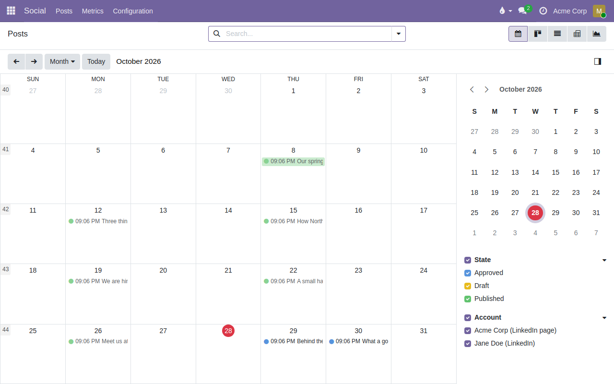
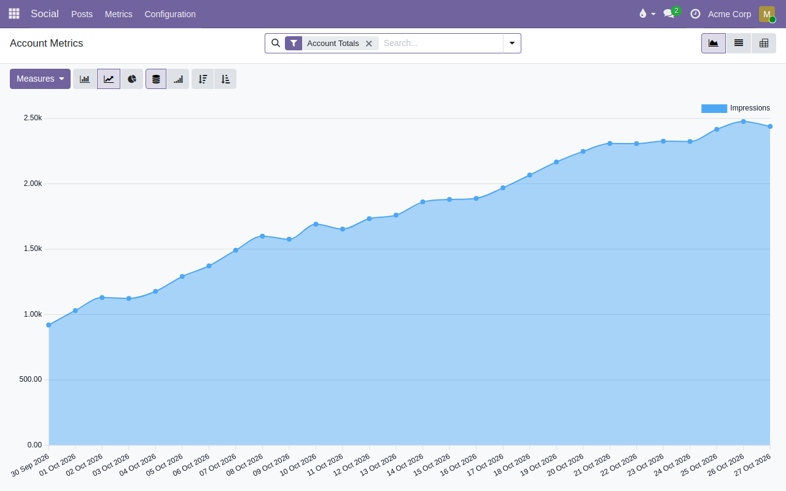

To use this module, you need to:

- Go to *Social > Posts* and create a post: write the text exactly as it
  should appear, pick the account, add tags and, optionally, an image.
- Set *Scheduled For*. A manager clicks **Approve**; approved posts are
  published automatically once that time has passed. **Publish Now** skips the
  wait.
- Editing the text, the image or the account of an approved post sends it
  back to draft, so the approval always matches what goes out.
- If the network refuses a post, it becomes *Failed* with the reason on the
  form, and it is not retried until someone sends it back to draft and
  approves it again.
- Use the calendar to see what goes out when, and drag a post to reschedule
  it. The kanban groups posts by status, and the side panel filters them by
  tag and account.

- Published posts show their metrics on the *Metrics* tab. *Social > Metrics*
  charts the account totals over time.

