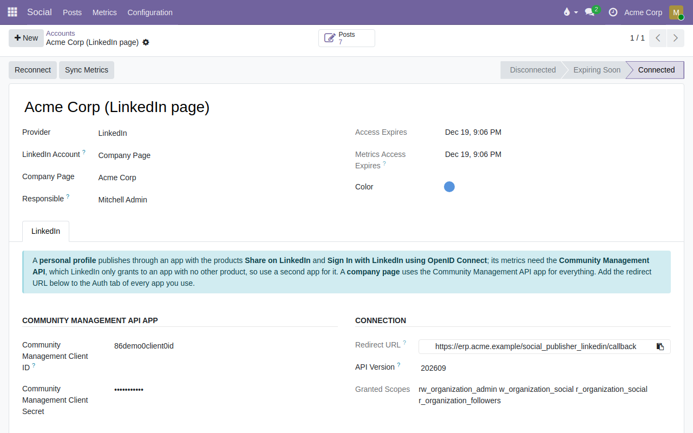

To configure this module, you need to:

- Create your app(s) at <https://www.linkedin.com/developers/apps>:
  - **Personal profile:** an app with the *Share on LinkedIn* and *Sign In with
    LinkedIn using OpenID Connect* products (self-service). Post analytics need
    the *Community Management API*, which LinkedIn reviews and only grants to an
    app with no other product, so use a second app for it. If that app also has
    `w_member_social` and `r_basicprofile`, it can run the profile alone.
  - **Company page:** the *Community Management API* app only. The person who
    connects must be an administrator of the page.
- Go to *Social > Configuration > Accounts*, create an account with the
  *LinkedIn* provider and choose *Personal Profile* or *Company Page*.
- On the *LinkedIn* tab, fill in the Client ID and Client Secret of your
  app(s), and add the *Redirect URL* shown there to the *Auth* tab of every
  LinkedIn app you use.
- Click **Connect** (and **Connect Metrics** for a profile that uses two apps).
  For a company page, pick the page among those you administer.

Access lasts about 60 days. The responsible user gets a to-do a week before it
expires; reconnect with one click.

